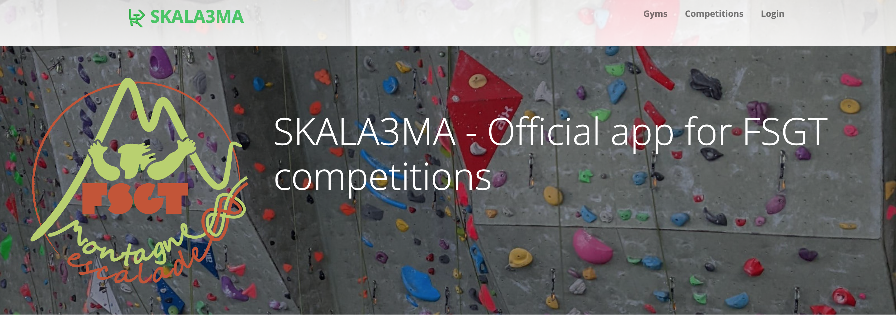
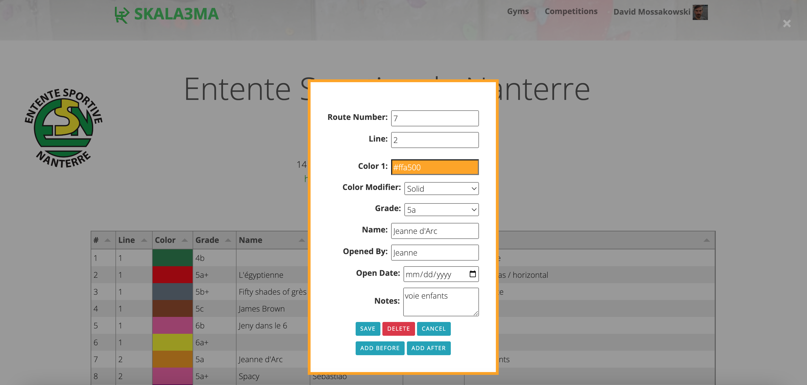

# SKALA3MA

Application to manage climbing gym routes, your daily climbing progress and competitions. 

https://skala3ma.com



## Features:
- Add and edit gym with logo, address, URL
- Add and edit multiple route sets
- Add and edit activities and mark each ascent as complete, flash or incomplete with a comment
- View graph of activities
- Create a competition with a poster
- Public competition registration link
- Easy route entry during competition
- Instant scoring and downloadable CSV results
- Multi-language
- Google and Facebook logins
- Printable route page for gyms

### Club rankings

Season and per-competition club rankings group registered clubs by gym ID, not
by their stored display names. Clubs without a registered gym ID are grouped by
their trimmed club name. Club ranking display names are trimmed; individual
scores and stored registration data are unchanged.

Club rankings and individual season rankings give equal point totals the same
rank, using competition numbering (for example, 1, 2, 2, 4). Participation counts
only order tied entries; they do not break rank ties. Tied individual season
ranks receive the same club-placement bonus.


## Technologies used

- Python 3
- Flask
  - OAuth libraries for authentication
- Jinja2 templates
- Apexcharts https://apexcharts.com/
- Tabulator https://tabulator.info/




## Development environment setup

The following instructions are for local development. 

Minimum version of Python is 3.7. You will need to have either Google or Facebook developer account and add the app there to enable local authentication.

1. Create certificate and key files:
``` 
 openssl req -newkey rsa:2048 -new -nodes -x509 -days 3650 -keyout key.pem -out cert.pem
```

2. Create Python Virtual Environment
```
  python -m venv .venv
```

3. Enter Virtual Environment
```
  source .venv/bin/activate
  
  If on windows:
  source .venv/scripts/activate
```

4. Install the requirements
```
  pip install -r requirements.txt
```
4. Modify the .env file to set the correct values

You should 

```
  DATA_DIRECTORY=<path to the data directory>
  GOOGLE_CLIENT_ID=<your Google client id>
  GOOGLE_CLIENT_SECRET=<your Google client secret>
  FACEBOOK_CLIENT_ID=<facebook client id>
  FACEBOOK_CLIENT_SECRET=<facebook client secret>
  ADMIN_USERS=user@email.com,user2@email.com
```
DATA_DIRECTORY can be relative but must exist. If omitted the system will create db and uploads directories in the current working directory.

See how to create your Google client ID and secret at [https://developers.google.com/identity/protocols/oauth2?hl=en](https://developers.google.com/identity/protocols/oauth2?hl=en)

To create your facebook client head to Meta console:
    https://developers.facebook.com/

You will need to create your development account and create a new app there. Add Facebook login product and add your URL to the redirect list of URLS: https://localhost:5000/facebook/auth

5. Run the server
```
  python server.py
```

You can also run the server using gunicorn:
```
  gunicorn --timeout 60 --limit-request-line 0 --limit-request-field_size 0 -b :5000 --keyfile=key.pem --certfile=cert.pem  -c app.py server:app
```

6. Using your favorite browser go to https://localhost:5000/


7. The application starts completely empty so to do any tests you will need to: 
  - create a gym 
  - create a competition 
  - sign up yourself for the competition
  - logout and sign up some anonymous users
  - manage the state of competition through admin console

### Sector photos on mobile and desktop

The sector photo button uses an unfiltered file input, like the gym-logo upload.
On mobile this lets the browser offer its native camera/files chooser instead
of an image-only picker; the exact options depend on the browser and OS.
On desktop it opens the normal file chooser. We intentionally omit `capture`
so users can still choose existing photos rather than being sent directly to
the camera. Only supported images up to 15 MB are accepted by the server;
videos and other unsupported files display an upload error.

To check this flow, edit a gym's sectors and use the photo button to upload an
existing image and, on a phone, a newly taken camera photo. Confirm the preview
updates and saving retains the photo. Cancelling the chooser should leave the
photo unchanged; selecting a video or non-image file should display an error.


9 Create trust store for android:

```
cd /Users/david/dev/gitrepos/skala3ma/mobile/Skala3maMobile/android/app
keytool -genkeypair -v -keystore skala3ma-upload.keystore -alias skala3ma \
  -keyalg RSA -keysize 2048 -validity 10000

  ````
  We will try to provide a test database that will have a good set of working data soon.

